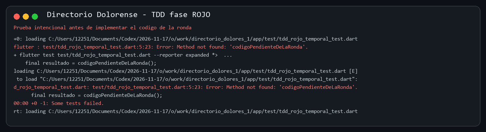
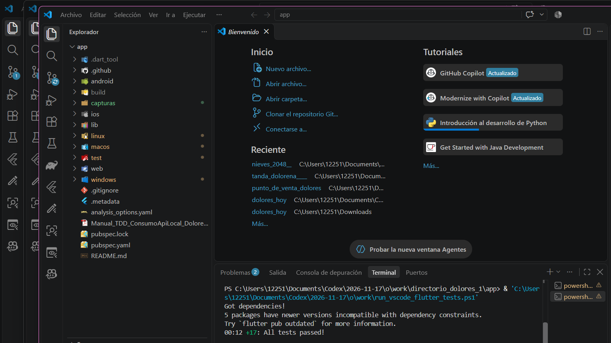

# Directorio Dolores

Aplicación de Flutter para consultar y administrar negocios de Dolores Hidalgo. Los datos se obtienen desde una API.

Permite listar, buscar, crear, eliminar y marcar negocios como favoritos.

## Cómo ejecutarlo

```bash
flutter pub get
flutter run
```

Para ejecutar las pruebas:

```bash
flutter test
```

## Todas las pruebas

Se ejecutaron las siguientes 17 pruebas:

1. Convierte la lista JSON en objetos de tipo negocio.
2. Lee todos los campos de un negocio desde JSON.
3. Un error 500 produce una excepción de servidor con su código.
4. Una falla de red produce una excepción de conexión.
5. Un tiempo de espera se maneja como falta de conexión.
6. Los campos opcionales ausentes usan valores normales.
7. Un negocio nuevo no envía identificador en el JSON.
8. Copiar un negocio permite cambiar sólo el favorito.
9. Un JSON incorrecto produce una excepción de respuesta inválida.
10. Una búsqueda envía el parámetro correctamente codificado.
11. Crear un negocio envía JSON con el tipo de contenido correcto.
12. Eliminar usa la petición DELETE con el identificador correcto.
13. Cargar datos termina en estado listo.
14. Cargar una lista vacía termina en estado vacío.
15. Un error del servidor termina con un mensaje de error.
16. Eliminar quita el negocio de la lista.
17. Cambiar favorito actualiza con la respuesta del servidor.

Resultado final: **17 pruebas aprobadas**.

## Capturas reales de las pruebas

### Fase roja



### Fase verde


